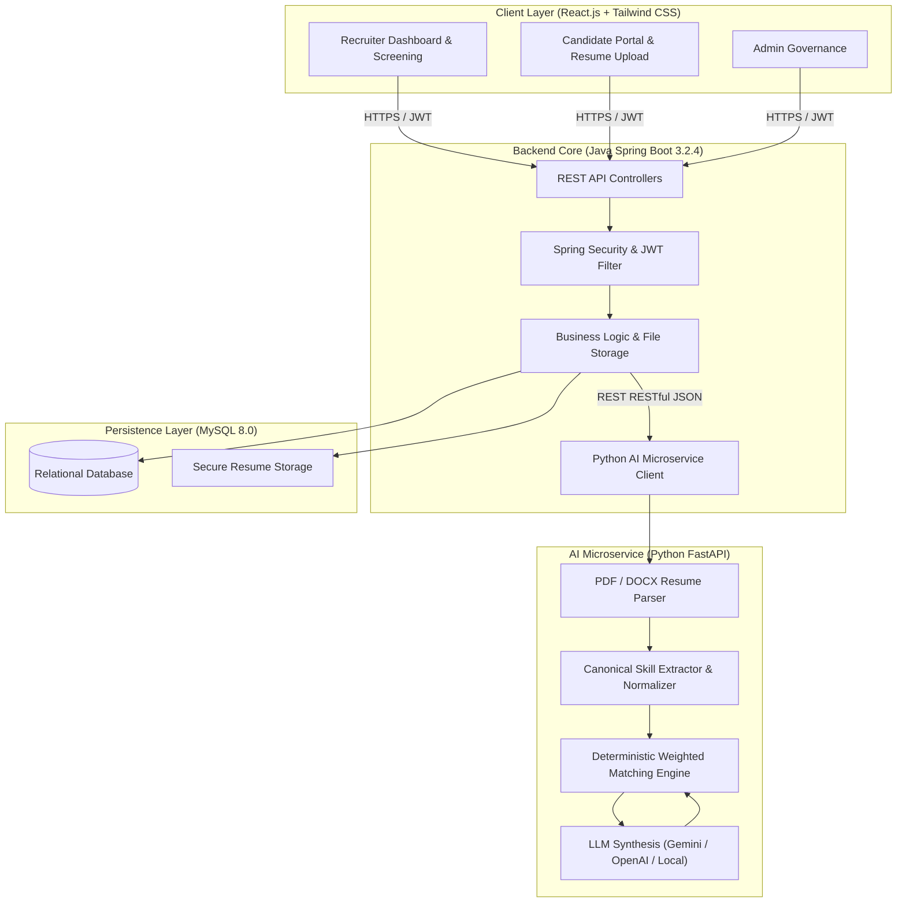

# HIRE MATCH AI – Intelligent Full-Stack AI Recruitment Platform

[](https://spring.io/projects/spring-boot)
[](https://fastapi.tiangolo.com/)
[](https://react.dev/)
[](https://www.mysql.com/)
[](https://www.docker.com/)

**Hire Match AI** is an enterprise-grade, full-stack, AI-powered recruitment platform that automates candidate resume screening, skill extraction, deterministic qualification matching, and candidate ranking. 

Designed for commercial HR teams handling hundreds of applications per opening, it transforms resume evaluation from a manual bottleneck into an explainable, data-driven, and transparent workflow.

---

## 1. System Architecture



---

## 2. Key Modules & Features

### A. Recruiter Dashboard & Management
- **Dashboard Telemetry**: Active job requisitions, total applications, applications under review, shortlisted candidates, upcoming interviews, average match score.
- **Recruitment Funnel**: Stage drop-off analysis tracking conversion from intake to hiring.
- **Upcoming Interviews**: Integrated interview schedule with meeting links and candidate profiles.

### B. Core AI Resume Screening & Semantic JD Matching
- **Deterministic 100-Point Scoring Algorithm**:
  $$\text{Score} = (W_{\text{req}} \times S_{\text{req}}) + (W_{\text{pref}} \times S_{\text{pref}}) + (W_{\text{exp}} \times S_{\text{exp}}) + (W_{\text{edu}} \times S_{\text{edu}}) + (W_{\text{proj}} \times S_{\text{proj}})$$
  - **Required Skills (50%)**: Exact & alias match against core job requirements.
  - **Preferred Skills (15%)**: Bonus points for nice-to-have competencies.
  - **Experience (15%)**: Evaluated against minimum and maximum experience thresholds.
  - **Education (10%)**: Degree level alignment.
  - **Projects & Track Record (10%)**: Project technological breadth and complexity.
- **Explainable Match Rationale**: Lists matched required skills, missing gaps, bonus skills, and human-readable executive summaries.
- **AI Recommendation Tiers**:
  - `85% - 100%`: **Strong Match**
  - `70% - 84%`: **Good Match**
  - `50% - 69%`: **Moderate Match**
  - `< 50%`: **Low Match**

### C. Candidate Job Portal & Applications
- **Job Discovery**: Keyword search, filters by employment type, location, and experience.
- **Instant AI Suitability Score**: Highlights personalized match tags for each job card.
- **Quick Apply**: Select saved resume or upload tailored resume with instant parsing.

### D. Multi-Candidate Comparison Matrix
- Select up to 3 candidates for any opening to review side-by-side:
  - Overall match score
  - Matched vs. missing competencies
  - Experience and education qualifications
  - Instant shortlisting and interview scheduling

### E. LLM Provider Integration with Robust Fallback
- Configurable via `.env`:
  - `GEMINI`: Google Gemini 1.5 Flash
  - `OPENAI`: OpenAI GPT-4o-mini
  - `LOCAL`: Zero-cost deterministic rule-based executive summary generator.
- Platform operates seamlessly offline or without paid API keys.

---

## 3. Technology Stack

| Component | Technologies |
|---|---|
| **Frontend** | React 18, React Router v6, Tailwind CSS, Lucide Icons, Recharts, Axios, Vite |
| **Backend** | Java 21, Spring Boot 3.2.4, Spring Data JPA, Spring Security, JWT, Maven |
| **AI Microservice** | Python 3.12, FastAPI, PyPDF2, python-docx, Pydantic, Scikit-Learn |
| **Database** | MySQL 8.0, Relational normalized schema, JPA/Hibernate |
| **Containerization** | Docker, Docker Compose multi-stage builds |

---

## 4. Default Demo Accounts (Pre-Seeded)

The platform comes pre-seeded with realistic data: 1 Admin, 2 Recruiters, 10 Candidates, 5 Job Openings, and 21 Scored Applications.

Password for all pre-seeded accounts: **`Password@123`**

| Role | Name | Email | Focus / Sample State |
|---|---|---|---|
| **Recruiter** | Sarah Jenkins | `sarah.recruiter@hirematch.ai` | CloudScale Solutions (Active Jobs & 21 Applicants) |
| **Recruiter** | David Chen | `david.chen@hirematch.ai` | FinTech Innovations |
| **Candidate** | Alex Rivera | `alex.rivera@example.com` | **94% Strong Match** for Java Developer |
| **Candidate** | Samantha Wu | `samantha.wu@example.com` | **97% Strong Match** for AI / NLP Engineer |
| **Candidate** | Marcus Vance | `marcus.vance@example.com` | **95% Strong Match** for React Frontend |
| **Admin** | Administrator | `admin@hirematch.ai` | User Governance & System Telemetry |

*Note: The Login screen includes a 1-Click Demo Bar to switch between accounts instantly without typing.*

---

## 5. Running the Application

### Option A: Running with Docker Compose (Recommended)

1. Clone or navigate to the project directory:
   ```bash
   cd "Hire Match Ai"
   ```

2. Start all 4 containers (MySQL, Python AI, Spring Boot, React):
   ```bash
   docker compose up --build
   ```

3. Open in your browser:
   - **Frontend App**: [http://localhost:3000](http://localhost:3000)
   - **Backend REST APIs**: [http://localhost:8080](http://localhost:8080)
   - **AI Microservice Docs**: [http://localhost:8000/docs](http://localhost:8000/docs)

---

### Option B: Running Locally

#### 1. Start Python AI Microservice
```bash
cd ai-service
python -m pip install -r requirements.txt
python -m uvicorn app.main:app --host 0.0.0.0 --port 8000 --reload
```
*Healthcheck: [http://localhost:8000/health](http://localhost:8000/health)*

#### 2. Start Java Spring Boot Backend
Ensure MySQL is running on `localhost:3306` with database `hirematchai` (or rely on the auto-fallback):
```bash
cd backend
mvn spring-boot:run
```
*Backend runs on: [http://localhost:8080](http://localhost:8080)*

#### 3. Start React Frontend
```bash
cd frontend
npm run dev
```
*Frontend runs on: [http://localhost:3000](http://localhost:3000)*

---

## 6. REST API Reference

### Authentication
- `POST /api/auth/register` - Create recruiter or candidate account
- `POST /api/auth/login` - Authenticate & receive JWT
- `GET /api/auth/me` - Current authenticated user profile

### Jobs Management
- `GET /api/jobs` - List published open jobs (keyword, location, type filters)
- `POST /api/jobs` - Create new job (Recruiter/Admin)
- `GET /api/jobs/{id}` - Job details & required skills
- `PUT /api/jobs/{id}` - Update job
- `PATCH /api/jobs/{id}/status` - Update status (OPEN, CLOSED, DRAFT)

### AI Screening & Analysis
- `POST /api/ai/analyze/{applicationId}` - Trigger AI screening for specific application
- `POST /api/ai/analyze/job/{jobId}` - Batch screen all applicants for a job
- `GET /api/ai/job/{jobId}/rankings` - Get ranked applicants sorted by match score
- `GET /api/ai/analysis/{applicationId}` - Detailed skill breakdown & explanation

### Applications
- `POST /api/applications` - Submit job application with resume
- `PATCH /api/applications/{id}/status` - Recruiter updates application status
- `GET /api/candidates/applications` - Candidate application tracking

### Candidate & Resumes
- `POST /api/candidates/resume` - Upload & parse PDF/DOCX resume
- `GET /api/candidates/resume/{id}/download` - Download resume file
- `GET /api/candidates/profile` - View profile completion & extracted skills

### Analytics & Administration
- `GET /api/analytics/overview` - Funnel, score distributions, monthly trends
- `GET /api/admin/overview` - Platform wide account & requisitions metrics
- `PUT /api/admin/users/{id}/status` - Toggle user enable/disable status
